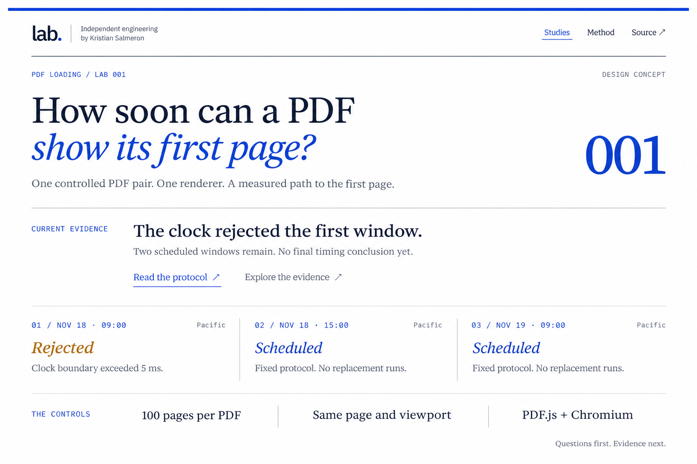
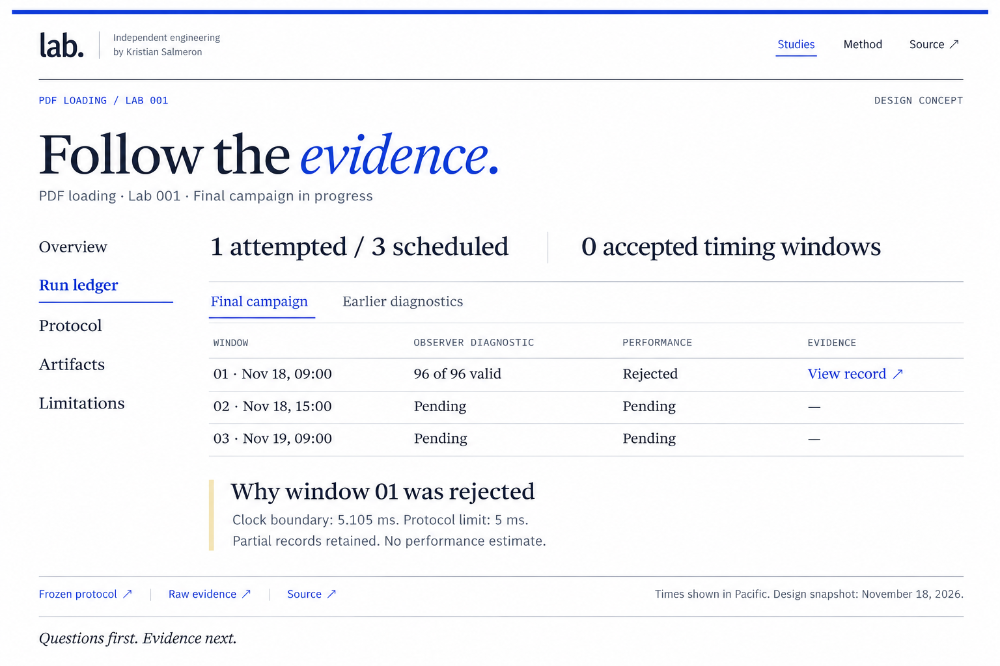

# Lab 001 website concepts

Design proposals, November 18, 2026. These are generated visual mockups, not implemented pages or deployed features. The active experiment and its controls remain unchanged.

## Recommended structure

Use an editorial research report as the public entry point, with an evidence explorer one click deeper. Both retain the live site's white background, blue rule and accents, serif headlines, monospaced labels and restrained layout.

The inspected [live site](https://lab.kristiansalmeron.com/) currently presents a proposed progress-update-cost study. Its [method](https://lab.kristiansalmeron.com/experiments/pdf-rendering/) concerns update cadence and a different PDF.js version. Lab 001's loading/linearization measurements do not test that hypothesis. Give the loading experiment its own page and explicit title; reconcile study numbering before implementation rather than replacing the existing proposal or labeling it tested.

Suggested routes, not existing pages: `/experiments/pdf-first-page/` for the report and `/experiments/pdf-first-page/evidence/` for the ledger. The live site links to the separate `kriscodes/lab` repository; these proposals do not modify that repository or deploy the benchmark harness.

## A — Editorial report

A question-led page with a plain-language evidence summary, fixed-window schedule, controls and links to the protocol and evidence. Best for readers arriving from the portfolio. After finalization, replace the provisional status with the audited conclusion, including an inconclusive result if that is what the evidence supports.

## B — Evidence explorer

A run ledger with distinct columns for observer validity and performance acceptance. Expanding a run would expose its rejection reason and retained artifacts. Keep earlier diagnostics separate from the final campaign. On mobile, use labeled stacked records and a compact section selector; preserve all status text without relying on color.

## Evidence and implementation boundaries

The snapshot is accurate to the current record: one final-campaign window attempted and rejected, two pending, no accepted final-campaign timing comparison. Its observer diagnostic had 96 valid workloads. The 5.105 ms clock boundary exceeded the unchanged 5 ms limit; it is not a page-render duration. Do not infer performance from software tests or observer acceptance. No speed-gain chart is proposed until accepted evidence exists.

These are static review mockups made with the built-in image-generation tool. [Prompts](prompts.json) preserve the design instructions and reference. Links and tabs drawn in the images are not functional. Before implementation, map them to audited evidence, define responsive and accessible behavior, and resolve public/private artifact access. No live browser benchmark, public PDF upload or hosting change is implied.

## Push and CI

The existing `feat/corpus-text-pair` branch was pushed to origin at `404b635bd0fc9f59c9590baa18ecdd2b5b207e2d`. GitHub's [Code quality run 44361814801](https://github.com/kriscodes/pdf-rendering-benchmark/actions/runs/44361814801) completed successfully on November 18, 2026 at 17:44:07 UTC. This supersedes the earlier documentation's historical statement that hosted CI had not yet run. It does not resolve the eleven retained lint findings or the deferred source security repair.
